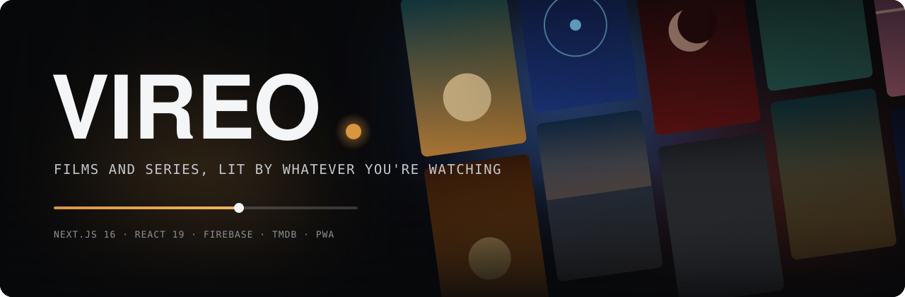
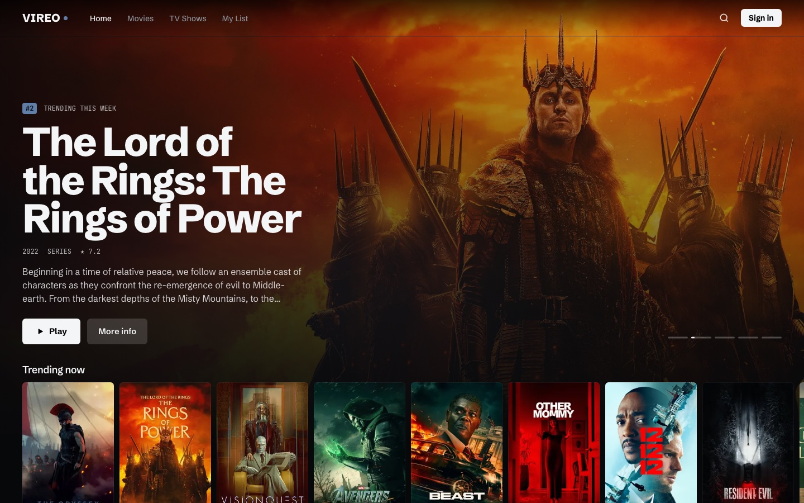
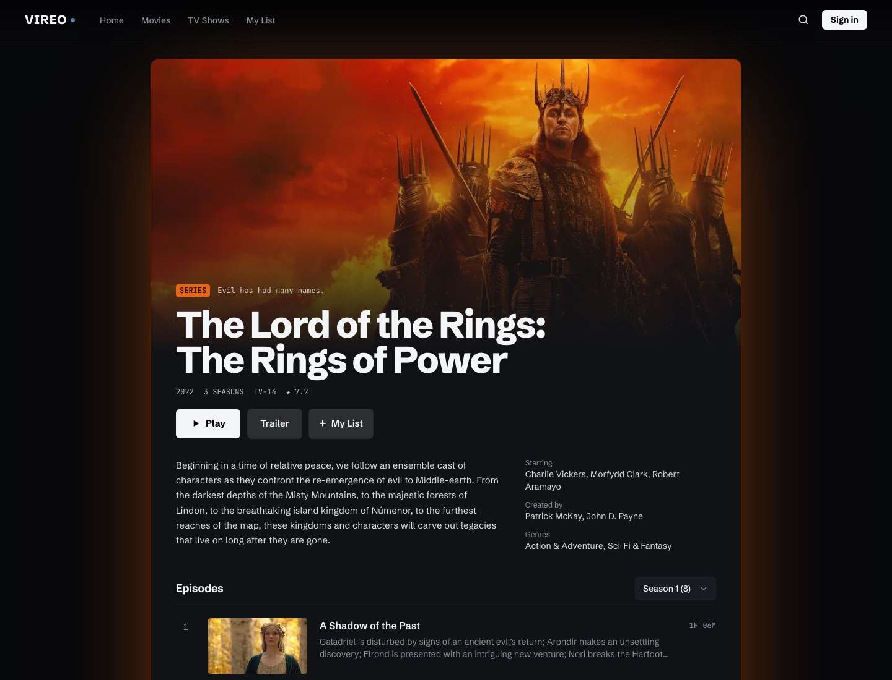
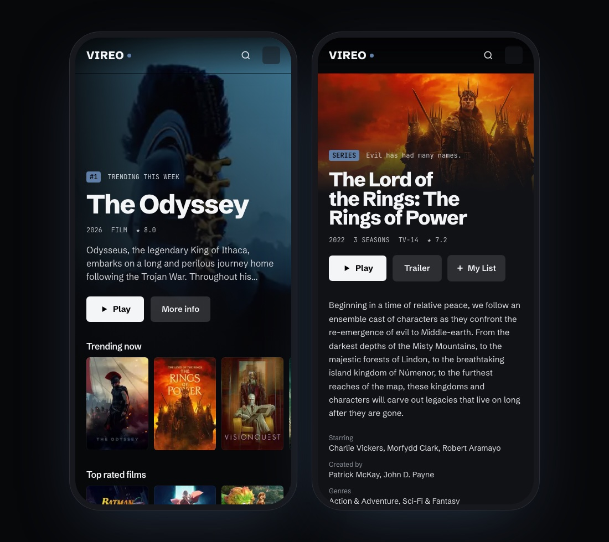

<p align="center">
  
</p>

<p align="center">
  A streaming web app where the interface takes its colour from the film on screen.<br>
  Built with Next.js 16, React 19, Firebase and the TMDB API.
</p>

<p align="center">
  <a href="https://vireo-chi.vercel.app"></a>
</p>

<p align="center">
  <sub>Create a free account to try profiles, My List, the player and Continue Watching. Every title plays an open-licence Blender film as a stand-in.</sub>
</p>

<p align="center">
  
</p>

## What it does

- **Browse.** A rotating banner of the week's trending titles, plus rows for top-rated films, trending series and genres. Films and TV Shows each have their own page.
- **Ambient colour.** Vireo works out each poster's dominant colour in the browser. Hovering a poster, changing the banner slide or opening a title tints the page, the detail pop-up and the player's seek bar in that film's colour.
- **Title details.** Clicking a poster opens a pop-up with its own URL: Back closes it, and a refresh or shared link opens it as a full page. It shows the trailer, cast, "More like this", and an episode list with a season picker for series.
- **Accounts and profiles.** Sign up with email or Google, pick favourite genres, and keep up to five profiles per account. Each profile gets its own "Because you like…" rows, My List and watch history.
- **Player.** A custom full-screen player with keyboard shortcuts, resume from where you stopped, a Continue Watching row, and a next-episode countdown for series.
- **My List and search.** Save titles per profile. Search films, series and people as you type, with recent searches and a Films/Series filter.
- **Installable and offline-ready.** Install Vireo from the browser to your home screen or dock. Pages you've opened, plus your profiles and My List, keep working without a connection, and changes sync when you're back online. Phones get a bottom tab bar.

<table>
  <tr>
    <td width="58%"></td>
    <td width="42%"></td>
  </tr>
</table>

## Tech stack

| | |
|---|---|
| Framework | [Next.js 16](https://nextjs.org) (App Router, Cache Components, Partial Prerendering), React 19, TypeScript |
| Styling | Tailwind CSS 4, Schibsted Grotesk and JetBrains Mono |
| Data | [TMDB API](https://developer.themoviedb.org) for titles, posters, trailers and cast. Called only on the server and cached for an hour. |
| Accounts and storage | Firebase Authentication (email/password, Google) and Cloud Firestore, on the free Spark plan |
| Video | Blender Foundation open movies, standing in for real films |

## Getting started

You need Node.js 20 or later, a free [Firebase](https://console.firebase.google.com) project and a free [TMDB](https://www.themoviedb.org/signup) account.

**1. Install**

```bash
git clone https://github.com/Haseeb35/Vireo.git
cd Vireo
npm install
```

**2. Set up Firebase**

1. Create a project and register a **Web** app.
2. In **Security → Authentication → Sign-in method**, enable **Email/Password** and **Google**.
3. In **Databases & Storage → Firestore**, create a database in production mode.
4. Open the **Rules** tab, paste the contents of [`firestore.rules`](firestore.rules) and click **Publish**. Each signed-in user can then read and write only their own data.

**3. Add your keys**

```bash
cp .env.example .env.local
```

Fill in `.env.local` with the Firebase web config (**Project settings → Your apps**) and your TMDB **API Read Access Token** (**Settings → API**). The TMDB token has no `NEXT_PUBLIC_` prefix, so it never reaches the browser. `.env.local` is git-ignored.

**4. Run**

```bash
npm run dev
```

Open [http://localhost:3000](http://localhost:3000). While a key is missing, the home page shows a setup checklist. It appears only in development.

The service worker (install and offline support) only runs in production mode, so it never caches files while you develop. To try it locally:

```bash
npm run build && npm start
```

## Project structure

```
src/
├── app/
│   ├── page.tsx                  Home
│   ├── title/[type]/[id]/        Title detail, full page
│   ├── @modal/(.)title/…         The same detail as a pop-up (intercepting route)
│   ├── watch/[type]/[id]/        Video player
│   ├── movies/  tv/              Browse pages
│   ├── search/  my-list/         Search and saved titles
│   ├── login/  signup/  reset/   Account pages
│   ├── onboarding/  profiles/    Genre picker and "Who's watching?"
│   └── actions.ts                Server actions (seasons, genre rows, search)
├── components/                   UI, grouped by feature
└── lib/
    ├── tmdb.ts                   Server-only TMDB client with caching
    ├── color.ts  ambient.ts      Poster colour extraction and the page tint
    ├── firebase.ts  auth.ts      Firebase setup and account actions
    └── profiles.ts  progress.ts  my-list.ts   Firestore data per profile
```

Firestore layout: `users/{uid}` holds the account's genres. Under it, `profiles/{profileId}` holds each profile, with its `list` and `progress` sub-collections.

## How the ambient colour works

1. When a poster scrolls into view, the browser loads a 64-pixel thumbnail through Next.js's image optimiser. Because the thumbnail comes from the same origin, a canvas can read its pixels.
2. [`color.ts`](src/lib/color.ts) sorts the pixels into 24 hue buckets, weighting saturated mid-tones highest, then normalises the winner so every film glows at a similar strength.
3. [`ambient.ts`](src/lib/ambient.ts) sets the colour as `--amb` on the page. Only the few elements that use it fade their `background-color`, so the browser never restyles the whole page on every frame.

## Roadmap

- [x] Home, title detail, accounts, profiles, player, My List, search
- [x] Install as an app (PWA), offline support and app icons
- [x] Bottom tab bar on phones
- [ ] Genre and year filters in search
- [ ] Kids profiles

## Credits

- Film and series data and images come from [TMDB](https://www.themoviedb.org). *This product uses the TMDB API but is not endorsed or certified by TMDB.*
- Playback uses the Blender Foundation's open movies *Big Buck Bunny*, *Sintel*, *Elephants Dream* and *Tears of Steel* ([CC BY](https://creativecommons.org/licenses/by/3.0/)), served from the Internet Archive.
- Vireo is a portfolio project. It isn't affiliated with any streaming service and doesn't stream commercial films.
